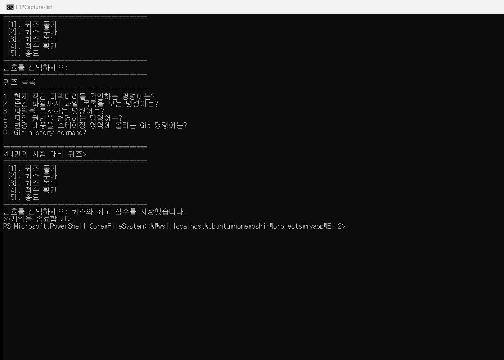
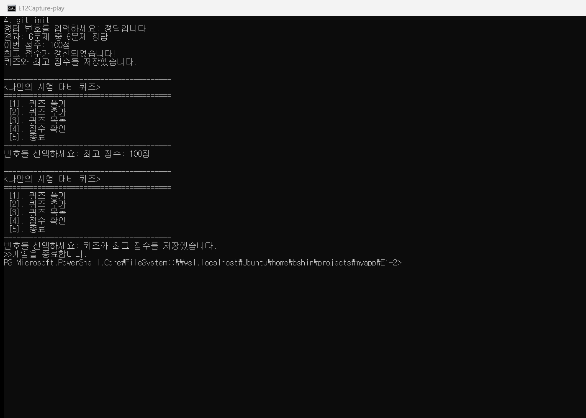
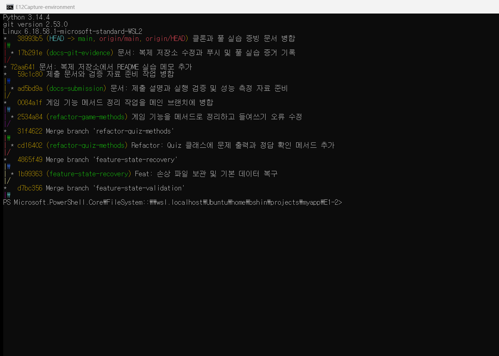

# Linux·Git 시험 대비 퀴즈

Python 표준 라이브러리만 사용하는 터미널용 4지선다 퀴즈 게임입니다.

## 프로젝트 개요와 주제 선정 이유

개발 입문 과정에서 배운 Linux 명령어와 Git 사용법을 반복해서 복습하기 위해 만들었습니다. 기본 퀴즈는 **5개**이며 `pwd`, `ls -a`, `cp`, `chmod`, `git add`를 다룹니다. 사용자가 문제를 추가할 수 있습니다.

저장소: <https://github.com/tikita12/E1-2> · 제출 브랜치: `main`

## 실행 방법

Python **3.10 이상**과 터미널이 필요하며 외부 패키지 설치는 필요하지 않습니다.

```bash
git clone git@github.com:tikita12/E1-2.git
cd E1-2
python3 main.py
```

SSH 키를 설정하지 않았다면 `git clone https://github.com/tikita12/E1-2.git`로 내려받을 수 있습니다. Windows에서는 환경에 따라 `py -3 main.py`를 사용합니다.

저장 경로는 현재 터미널 위치가 아니라 **main.py가 있는 프로젝트 폴더**입니다. 다른 폴더에서 절대 경로로 실행해도 같은 위치에 저장합니다.

## 구현한 기능

| 메뉴 | 동작 |
|---|---|
| 1. 퀴즈 풀기 | 전체 문제를 무작위 순서로 출제, 정답·오답 안내, 결과와 점수 표시 |
| 2. 퀴즈 추가 | 문제, 선택지 4개, 정답 번호 입력 후 즉시 저장 |
| 3. 퀴즈 목록 | 문제 번호와 질문 표시, 빈 목록 안내 |
| 4. 점수 확인 | 최고 점수 표시, 플레이 전 상태 구분 |
| 5. 종료 | 저장 시도 후 종료 |

- 점수는 `round(정답 수 / 전체 문제 수 * 100)`으로 계산해 100점 기준으로 비교합니다.
- 첫 플레이 전 최고 점수는 `None`이며 전부 틀린 `0점`과 구분합니다.
- 메뉴는 1~5, 정답은 1~4만 허용합니다. 문자·빈 입력·범위 밖 숫자는 재입력받고 앞뒤 공백은 제거합니다.
- 문제·선택지의 빈 문자열과 공백만 있는 입력을 거절합니다.
- Ctrl+C 및 EOF(WSL/Linux의 빈 입력란에서 Ctrl+D)를 처리하고 가능한 데이터를 저장한 뒤 종료합니다. 미완성 문제와 끝내지 않은 게임의 점수는 반영하지 않습니다.
- 보너스 과제 **랜덤 출제**를 구현했습니다. 플레이를 시작할 때 퀴즈 목록을 복사한 뒤 표준 라이브러리의 `random.shuffle()`로 순서를 섞습니다. 모든 문제는 한 번씩 출제하며 저장 파일과 목록 보기의 순서는 유지합니다. 무작위이므로 이전과 같은 순서가 나올 수도 있습니다.
- 문제 수 선택·힌트·삭제·전체 점수 히스토리는 이번 구현에 포함하지 않았습니다.

## 파일 구조

```text
E1-2/
├── main.py                  # 모델, 게임, 입력 검사, 파일 처리
├── state.json               # 퀴즈와 최고 점수(없으면 첫 저장 때 생성)
├── README.md
├── tests/test_game.py       # 임시 폴더를 사용하는 자동 검증
├── tools/benchmark.py       # 5/1,000/10,000개 성능 측정
└── docs/
    ├── validation.md        # 테스트 결과와 한계
    ├── performance.md       # 성능 실측과 개선 방향
    ├── execution.md         # 실제 프로그램 입력·출력
    ├── environment.md       # 실행 환경과 Git 정보
    ├── git-practice.md      # clone/pull 실습 기록
    └── screenshots/README.md # 실제 실행 화면과 캡처 방법
```

학습용 코드는 한 파일에서 읽되 역할별 함수·클래스로 분리했습니다. 검증과 제출 증거는 별도 폴더로 분리했습니다. 기존 과제 PDF와 `_Tp` 파일은 실행에 사용하지 않습니다.

## 클래스와 함수의 책임

| 구성 요소 | 책임 |
|---|---|
| `Quiz` | 문제 하나의 정보, `display()` 출력, `check_answer()` 정답 확인 |
| `QuizGame` | 퀴즈 목록·최고 점수와 메뉴·플레이·추가·목록·점수·저장·불러오기·종료 관리 |
| `get_number`, `get_menu_choice`, `get_text` | 입력 변환·범위·빈 문자열 검사와 재입력 |
| `play_quiz` | 문제 하나의 출력 요청, 답변 입력, 정오답 안내 |
| `save_state`, `load_state` | JSON 파일 입출력과 객체·딕셔너리 변환 |
| `validate_state`, `backup_corrupt_state` | 자료형·범위 검사와 손상 원본 보관 |

관련 데이터와 동작을 묶기 위해 클래스를 사용했습니다. 여러 `Quiz` 객체가 같은 출력·정답 확인 코드를 재사용하고 `QuizGame`이 게임 상태를 관리합니다. `__init__`은 초기 상태를 설정하며 `self`는 현재 객체입니다.

입력 검사와 파일 처리를 게임 진행에서 분리해 저장 형식 변경이 정답 판정 코드에 영향을 덜 주게 했습니다. `if __name__ == "__main__":` 아래 코드는 직접 실행할 때만 동작하므로 테스트에서 클래스를 가져와도 메뉴가 실행되지 않습니다.

## 과제 코드로 이해하는 핵심 개념

각 예제는 실제 `main.py`에서 발췌했습니다. 입력 예시를 코드에 넣어 따라가며 결과를 확인하세요. 아래 실행 흐름은 이해를 위한 예시입니다.

### 1. 입력한 2는 아직 숫자가 아니다

```python
number = int(input(prompt).strip())
```

| 코드에 넣을 값 / 시점 | 실행 결과 |
|---|---|
| input(prompt) | " 2 " · str |
| strip() | "2" · str |
| int(...) | 2 · int |

**문자열 → 공백 제거 → 정수 변환**

int("abc")는 ValueError. 다음 페이지의 except로 이동합니다.

### 2. 잘못 입력하면 어디로 돌아갈까?

```python
def get_number(prompt):
    while True:
        try:
            number = int(input(prompt).strip())
        except ValueError:
            print("숫자를 입력해 주세요.")
            continue

        if number in [1, 2, 3, 4 ]:
            return number

        print("1~4 사이의 번호를 입력해주세요")
```

| 코드에 넣을 값 / 시점 | 실행 결과 |
|---|---|
| abc 입력 | except → 안내 → continue → 다시 입력 |
| 9 입력 | 변환 성공 → 범위 검사 실패 → 다시 입력 |
| 2 입력 | 범위 검사 통과 → return 2 → 함수 종료 |

**continue는 반복의 다음 회차, return은 함수 종료**

입력 3가지를 각각 따라가며 while의 시작점과 return 위치를 찾으세요.

### 3. 빈 문제는 왜 등록되지 않을까?

```python
def get_text(prompt):
    while True:
        text = input(prompt).strip()

        if text:
            return text

        print("내용을 입력해주세요.")
```

| 코드에 넣을 값 / 시점 | 실행 결과 |
|---|---|
| 공백만 입력 | "   ".strip() → "" |
| if text | 빈 문자열은 False → 안내 후 반복 |
| 내용 입력 | "문제" → True → return text |

**빈 문자열은 조건식에서 False**

strip은 원래 문자열을 고치는 것이 아니라 공백을 제거한 문자열을 반환합니다.

### 4. 문제 하나를 객체로 묶기

```python
class Quiz: #문제의 정보를 관리하는 클래스
    def __init__(self, question, choices, answer):
        self.question = question
        self.choices = choices
        self.answer = answer
```

| 코드에 넣을 값 / 시점 | 실행 결과 |
|---|---|
| Quiz("현재 위치?", ["ls", "pwd", "cd", "mkdir"], 2) | 새 Quiz 객체 생성 |
| __init__의 self | 지금 생성한 퀴즈 객체 |
| self.answer = answer | 이 객체의 정답 속성에 2 저장 |

**클래스는 구조, 객체는 실제 문제 하나**

같은 클래스로 두 객체를 만들면 각 객체가 자신의 질문과 정답을 가집니다.

### 5. 번호와 선택지가 함께 나오는 이유

```python
for number, choice in enumerate(self.choices, start=1):
    print(f"{number}. {choice}")
```

| 코드에 넣을 값 / 시점 | 실행 결과 |
|---|---|
| choices = ["ls", "pwd", "cd", "mkdir"] | 선택지 목록 예시 |
| 첫 반복 | number=1, choice="ls" → 1. ls |
| 두 번째 반복 | number=2, choice="pwd" → 2. pwd |

**enumerate는 번호와 항목을 함께 제공**

start=1은 화면 번호입니다. 파이썬 리스트의 첫 인덱스는 여전히 0입니다.

### 6. 정답 비교는 값을 돌려준다

```python
def check_answer(self, user_answer):
    return user_answer == self.answer
```

| 코드에 넣을 값 / 시점 | 실행 결과 |
|---|---|
| 정답 속성 self.answer = 2 | 객체에 저장된 정답 |
| check_answer(2) | 2 == 2 → True 반환 |
| check_answer(1) | 1 == 2 → False 반환 |

**return True와 print("정답")는 다르다**

이 메서드는 출력하지 않습니다. 반환된 bool을 play_quiz가 받아 정오답 안내를 합니다.

### 7. True가 점수로 바뀌는 순간

```python
for current_quiz in play_order:
    result = play_quiz(current_quiz)

    if result:
        correct_count += 1
```

| 코드에 넣을 값 / 시점 | 실행 결과 |
|---|---|
| correct_count = 0 | 플레이 시작 때 정답 수 초기화 |
| result = True | if 통과 → correct_count가 1 증가 |
| result = False | 증가 코드를 건너뜀 |

**지역 변수에 한 번의 게임 결과를 누적**

current_quiz는 Quiz 객체이고 result는 bool입니다. 같은 변수로 착각하지 마세요.

### 8. 처음 받은 0점도 기록해야 한다

```python
score = round(correct_count / len(self.quizzes) * 100)
print(f"이번 점수: {score}점")

if self.best_score is None or score > self.best_score:
    self.best_score = score
    print("최고 점수가 갱신되었습니다!")
```

| 코드에 넣을 값 / 시점 | 실행 결과 |
|---|---|
| 4개 정답 / 5문제 | round(4 / 5 * 100) → 80 |
| best_score=None, score=0 | 미플레이 조건이 True → 최고 점수 0 기록 |
| best_score=80, score=60 | 두 조건 모두 False → 80 유지 |

**None은 미플레이, 0은 실제 점수**

or는 왼쪽이 True이면 오른쪽 비교를 생략합니다. 그래서 None과 숫자를 비교하지 않습니다.

### 9. 보너스 과제: 복사한 목록만 섞기

```python
play_order = self.quizzes.copy()
random.shuffle(play_order)
```

| 코드에 넣을 값 / 시점 | 실행 결과 |
|---|---|
| 원본 self.quizzes | [문제A, 문제B, 문제C] |
| copy → shuffle 후 예시 | play_order: [문제C, 문제A, 문제B] |
| 원본 목록 | self.quizzes: [문제A, 문제B, 문제C] 유지 |

**새 목록을 만들고 그 순서만 무작위로 변경**

얕은 복사이므로 내부 Quiz 객체는 공유합니다. shuffle의 반환값은 None이며 같은 순서가 다시 나올 수도 있습니다.

### 10. 객체를 JSON에 저장할 모양으로 바꾸기

```python
for quiz in quizzes:
    quiz_data.append({
        "question": quiz.question,
        "choices": quiz.choices,
        "answer": quiz.answer

    })
data = {
    "quizzes": quiz_data,
    "best_score": best_score
}
```

| 코드에 넣을 값 / 시점 | 실행 결과 |
|---|---|
| quiz.question / quiz.answer | 객체의 속성을 읽음 |
| quiz_data.append({...}) | 딕셔너리를 목록에 추가 |
| data의 quizzes / best_score | 문제 목록과 최고 점수를 하나로 묶음 |

**Quiz 객체 → dict와 list → JSON**

json.dump는 이렇게 만든 data를 파일에 씁니다. json.load로 읽은 딕셔너리는 load_state에서 다시 Quiz 객체로 만듭니다.

### 11. 파일을 열고 한글 데이터를 쓰기

```python
with open(STATE_FILE, "w", encoding="utf-8") as file:
    json.dump(data, file, ensure_ascii=False, indent=4)
```

| 코드에 넣을 값 / 시점 | 실행 결과 |
|---|---|
| open(..., "w") | 파일을 쓰기 모드로 열기 |
| json.dump(data, file, ...) | dict/list를 JSON 텍스트로 기록 |
| with 블록 종료 | 파일 닫기 |

**메모리의 값은 저장에 성공해야 파일에 남는다**

ensure_ascii=False는 한글을 읽기 쉽게, indent=4는 들여쓰기를 지정합니다. "w"는 기존 파일을 덮어씁니다.

### 12. 읽힌 JSON이 올바른 퀴즈라는 보장은 없다

```python
answer = item.get("answer")
if type(answer) is not int or not 1 <= answer <= 4:
    raise ValueError("정답 번호는 1~4 사이의 정수여야 합니다.")
```

| 코드에 넣을 값 / 시점 | 실행 결과 |
|---|---|
| answer=2 | 정수이고 1~4 → 통과 |
| answer=9 또는 "2" | 범위 또는 자료형 오류 → raise ValueError |
| answer=True | type(True)는 bool → 정수 조건에서 제외 |

**JSON 읽기 성공과 게임 데이터 검증은 별개**

발생한 ValueError는 load_state의 except에서 처리합니다. 손상 원본을 보관한 뒤 기본 퀴즈로 시작합니다.

### 13. Ctrl+C를 누르면 저장은 누가 할까?

```python
except KeyboardInterrupt:
    print("\nCtrl+C로 종료를 요청했습니다.")

except EOFError:
    print("\n입력이 종료되어 게임을 종료합니다.")

finally:
    self.save()
    print(">>게임을 종료합니다.")
```

| 코드에 넣을 값 / 시점 | 실행 결과 |
|---|---|
| Ctrl+C | KeyboardInterrupt → 안내 |
| Ctrl+D / 입력 종료 | EOFError → 안내 |
| finally | self.save() → 종료 안내 |

**종료 경로를 한곳에서 정리한다**

이 코드는 QuizGame.run의 끝부분입니다. finally도 강제 프로세스 종료나 전원 차단까지 보장하지는 않습니다.

### 14. 프로그램은 이 세 줄에서 시작한다

```python
if __name__ == "__main__":
    game = QuizGame(quizzes, None)
    game.load()
    game.run()
```

| 코드에 넣을 값 / 시점 | 실행 결과 |
|---|---|
| QuizGame(quizzes, None) | 기본 문제와 미플레이 점수로 객체 생성 |
| game.load() | 파일을 읽어 게임 상태 복원 |
| game.run() | 메뉴 반복 시작 |

**직접 실행할 때만 시작 코드를 수행**

테스트에서 import main을 해도 이 블록은 실행되지 않아, 메뉴 입력을 기다리지 않고 함수를 검사할 수 있습니다.

## state.json 설명

프로젝트 루트에 UTF-8로 저장합니다. 다음은 구조를 보여 주는 **문제 1개짜리 예시**이며 기본 문제는 5개입니다.

```json
{
    "quizzes": [
        {
            "question": "현재 작업 디렉터리를 확인하는 명령어는?",
            "choices": ["ls", "pwd", "cd", "mkdir"],
            "answer": 2
        }
    ],
    "best_score": null
}
```

- `quizzes`: 퀴즈 딕셔너리 목록. 빈 목록도 유효합니다.
- `question`: 공백만으로 이루어지지 않은 문자열.
- `choices`: 비어 있지 않은 문자열 4개.
- `answer`: 1~4의 정수.
- `best_score`: 플레이 전에는 `null`, 이후에는 0~100의 정수. 파이썬의 `None`이 JSON의 `null`로 저장됩니다.

JSON은 목록·딕셔너리를 표현하기 쉽고 사람이 읽을 수 있으며 표준 라이브러리로 처리할 수 있어 선택했습니다. 매번 전체 파일을 읽고 쓰므로 대량 데이터나 동시 수정에는 불리합니다. JSON 자체가 암호화나 값 검사를 제공하지는 않습니다.

### 불러오기와 저장 순서

1. 기본 퀴즈로 게임 객체를 만들고 `game.load()`를 호출합니다.
2. JSON의 구조·값을 검사한 다음 `Quiz` 객체로 변환합니다. 파일이 없으면 기본 퀴즈와 미플레이 점수로 시작합니다.
3. 퀴즈 등록 완료 직후와 전체 문제 풀이 완료 직후 저장합니다.
4. 5번 종료 및 Ctrl+C·EOF 처리의 `finally`에서 다시 저장을 시도합니다.

저장 전 기존 파일을 검사하고, 객체를 딕셔너리로 변환해 `json.dump(..., ensure_ascii=False, indent=4)`로 기록합니다. 저장 실패 시 성공 메시지 대신 원인을 안내합니다.

### 오류와 복구

| 상황 | 처리 |
|---|---|
| 파일 없음 | 기본 퀴즈로 시작, 다음 저장에서 생성 |
| JSON 문법·인코딩·자료형·범위 오류 | 원본을 `state.corrupt-날짜-시간.json`으로 보관, 기본 퀴즈와 `None`으로 초기화 |
| 보관 실패 | 기본 퀴즈로 실행하되 저장 전 검사가 기존 손상 파일의 덮어쓰기를 차단 |
| 읽기 실패 | 원인 안내 후 기본 퀴즈로 시작 |
| 쓰기 실패 | 실패 안내. 경로와 쓰기 권한을 확인한 뒤 재시도 |

손상 파일 보관은 이전 정상 점수로 자동 복원하는 기능이 아닙니다. 수동 복구는 프로그램을 종료한 상태에서 보관 파일의 복사본을 수정·검증한 뒤 `state.json`으로 되돌립니다. 원본 보관 파일은 복구 완료 전까지 유지합니다.

현재 저장은 직접 덮어쓰기이므로 저장 중 강제 종료·전원 차단 시 일부만 기록될 수 있습니다. 일반 입력 중 Ctrl+C는 처리하지만 저장 자체를 다시 중단시키는 반복 신호까지 보장하지 않습니다. 향후 임시 파일 작성 후 교체와 정상 파일의 세대별 백업으로 보완할 수 있습니다.

## 검증과 성능

```bash
python3 -m unittest discover -s tests -v
python3 tools/benchmark.py
```

검증은 임시 폴더를 사용해 실제 `state.json`을 변경하지 않습니다. [검증 결과](docs/validation.md), [성능 측정](docs/performance.md), [실행 기록](docs/execution.md)을 참고하세요. 권한 오류는 mock으로 재현했으며 실제 OS 권한 변경 실험과 구분합니다.

## Git 작업 규칙

- 기능 단위로 브랜치를 만들고 수정·검증·커밋한 뒤 `main`에 병합합니다.
- 메시지에는 변경 내용을 명시합니다. 예: `기능: 퀴즈 저장 구현`, `수정: 빈 선택지 등록 방지`, `구조: 게임 메서드 분리`, `문서: 실행 방법 추가`.
- 의미 있는 기능 커밋 10개 이상과 브랜치 병합 기록이 있습니다. 초기의 `:wq`처럼 설명이 부족한 메시지도 이력에 보존하며 이후 메시지는 구체적으로 작성합니다.
- 작업 파일을 지정해 `git add`하고, `--no-ff`로 병합 커밋을 남깁니다.
- [clone·pull 실습](docs/git-practice.md)과 [Git 환경·그래프](docs/environment.md)에 실제 명령과 결과를 기록합니다.

## 요구 변경 시 영향

| 변경 요청 | 수정 대상 | 확인할 내용 |
|---|---|---|
| 점수 방식 변경 | `QuizGame.play`, `validate_state` | 기존 최고 점수와 비교·파일 호환성 |
| 선택지 5개 | 입력 범위, `add_quiz`, `validate_state` | 기존 4지선다 파일, 출력·판정 |
| 힌트 추가 | `Quiz`, 추가 입력, 입출력 | 기존 파일에 필드가 없을 때 기본값 |
| 저장 형식·위치 변경 | `STATE_FILE`, 입출력 함수 | 데이터 이전·권한·복구 |
| 검색·삭제 추가 | `QuizGame`과 메뉴 | 삭제 후 저장·빈 목록·식별자·검색 비용 |

## 제출 자료

이미지를 제외하는 AI 사전평가에서도 읽을 수 있도록 코드와 마크다운 실행 기록을 함께 제출합니다. 실제 콘솔 창에서 촬영한 [스크린샷 6장](docs/screenshots/README.md)을 첨부했습니다. 자동 입력을 사용했으며 기존 저장 데이터는 변경하지 않았습니다.

Git 실습 메모: 이 문장은 별도로 clone한 저장소에서 README를 수정하는 실습으로 추가했습니다.


## 실행 화면

### 메뉴


### 퀴즈 추가와 목록




### 플레이 결과와 재실행 점수




### 개발 환경과 Git 병합 기록



## 발표 자료와 최신 검증

[presentation.html](presentation.html)을 다운로드한 프로젝트 폴더에서 브라우저로 열면 발표 자료를 볼 수 있습니다. 프레젠테이션에는 실제 스크린샷 6장을 내장했으므로 HTML 파일만 내려받아도 이미지가 표시됩니다. 목차의 ‘실제 콘솔 스크린샷’에서 클릭해 확대할 수 있습니다. 방향키로 이동하고, 목차 버튼으로 슬라이드를 선택하며, N 키로 해당 슬라이드의 발표 대본을 표시합니다.

랜덤 출제 보너스, 원본 목록 유지 방식, 최신 자동 테스트 **14개 통과**를 발표 자료에도 반영했습니다. GitHub의 HTML 파일 화면은 소스 보기이므로 로컬 브라우저에서 열어 주세요.

기존 스크린샷은 랜덤 출제 추가 전 기능 검증 화면입니다. 저장·추가·점수·환경 증거로 유지하며 무작위 순서의 증거로 사용하지 않습니다. 최신 검증은 [검증 보고서](docs/validation.md)를 참고하세요.

랜덤 출제는 과제의 **선택 보너스 과제**로 구현했습니다. 발표 자료에도 ‘보너스 과제: 랜덤 출제’로 구분해 표시합니다.
