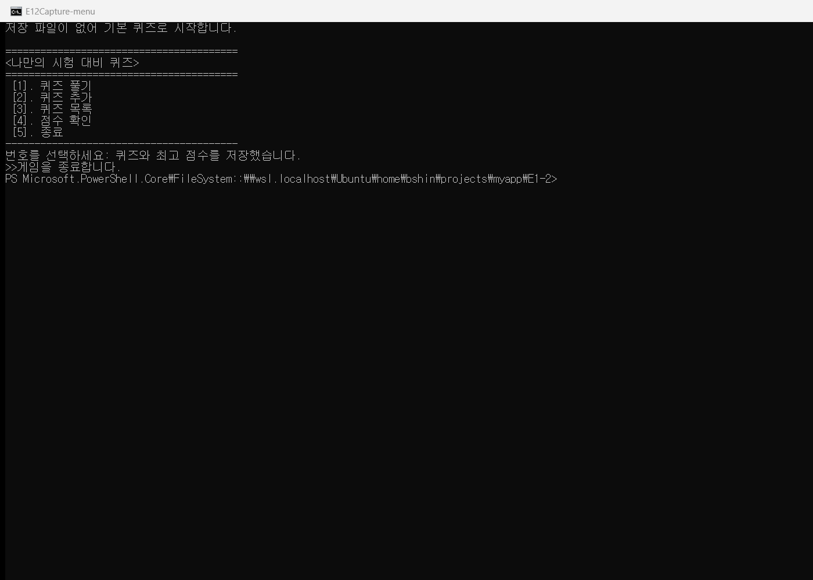
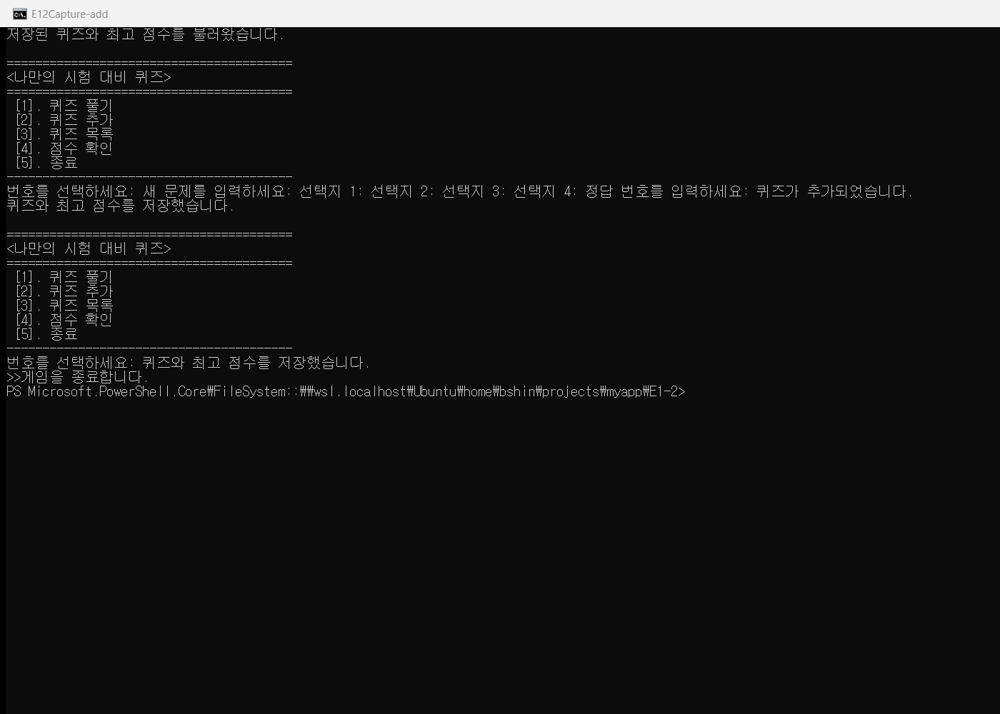

# Linux·Git 시험 대비 퀴즈

Python 표준 라이브러리만 사용하는 터미널용 4지선다 퀴즈 게임입니다.

## 프로젝트 개요와 주제 선정 이유

개발 입문 과정에서 배운 Linux 명령어와 Git 사용법을 반복해서 복습하기 위해 만들었습니다. 기본 퀴즈는 **5개**이며 `pwd`, `ls -a`, `cp`, `chmod`, `git add`를 다룹니다. 사용자가 문제를 추가할 수 있습니다.

저장소: <https://github.com/tikita12/E1-2> · 제출 브랜치: `main`

## 실행 방법

Python **3.10 이상**과 터미널이 필요하며 외부 패키지 설치는 필요하지 않습니다.

```bash
git clone git@github.com:tikita12/E1-2.git
cd E1-2
python3 main.py
```

SSH 키를 설정하지 않았다면 `git clone https://github.com/tikita12/E1-2.git`로 내려받을 수 있습니다. Windows에서는 환경에 따라 `py -3 main.py`를 사용합니다.

저장 경로는 현재 터미널 위치가 아니라 **main.py가 있는 프로젝트 폴더**입니다. 다른 폴더에서 절대 경로로 실행해도 같은 위치에 저장합니다.

## 구현한 기능

| 메뉴 | 동작 |
|---|---|
| 1. 퀴즈 풀기 | 전체 문제를 무작위 순서로 출제, 정답·오답 안내, 결과와 점수 표시 |
| 2. 퀴즈 추가 | 문제, 선택지 4개, 정답 번호 입력 후 즉시 저장 |
| 3. 퀴즈 목록 | 문제 번호와 질문 표시, 빈 목록 안내 |
| 4. 점수 확인 | 최고 점수 표시, 플레이 전 상태 구분 |
| 5. 종료 | 저장 시도 후 종료 |

- 점수는 `round(정답 수 / 전체 문제 수 * 100)`으로 계산해 100점 기준으로 비교합니다.
- 첫 플레이 전 최고 점수는 `None`이며 전부 틀린 `0점`과 구분합니다.
- 메뉴는 1~5, 정답은 1~4만 허용합니다. 문자·빈 입력·범위 밖 숫자는 재입력받고 앞뒤 공백은 제거합니다.
- 문제·선택지의 빈 문자열과 공백만 있는 입력을 거절합니다.
- Ctrl+C 및 EOF(WSL/Linux의 빈 입력란에서 Ctrl+D)를 처리하고 가능한 데이터를 저장한 뒤 종료합니다. 미완성 문제와 끝내지 않은 게임의 점수는 반영하지 않습니다.
- 보너스 과제 **랜덤 출제**를 구현했습니다. 플레이를 시작할 때 퀴즈 목록을 복사한 뒤 표준 라이브러리의 `random.shuffle()`로 순서를 섞습니다. 모든 문제는 한 번씩 출제하며 저장 파일과 목록 보기의 순서는 유지합니다. 무작위이므로 이전과 같은 순서가 나올 수도 있습니다.
- 문제 수 선택·힌트·삭제·전체 점수 히스토리는 이번 구현에 포함하지 않았습니다.

## 파일 구조

```text
E1-2/
├── main.py                  # 모델, 게임, 입력 검사, 파일 처리
├── state.json               # 퀴즈와 최고 점수(없으면 첫 저장 때 생성)
├── README.md
├── tests/test_game.py       # 임시 폴더를 사용하는 자동 검증
├── tools/benchmark.py       # 5/1,000/10,000개 성능 측정
└── docs/
    ├── validation.md        # 테스트 결과와 한계
    ├── performance.md       # 성능 실측과 개선 방향
    ├── execution.md         # 실제 프로그램 입력·출력
    ├── environment.md       # 실행 환경과 Git 정보
    ├── git-practice.md      # clone/pull 실습 기록
    └── screenshots/README.md # 실제 실행 화면과 캡처 방법
```

학습용 코드는 한 파일에서 읽되 역할별 함수·클래스로 분리했습니다. 검증과 제출 증거는 별도 폴더로 분리했습니다. 기존 과제 PDF와 `_Tp` 파일은 실행에 사용하지 않습니다.

## 클래스와 함수의 책임

| 구성 요소 | 책임 |
|---|---|
| `Quiz` | 문제 하나의 정보, `display()` 출력, `check_answer()` 정답 확인 |
| `QuizGame` | 퀴즈 목록·최고 점수와 메뉴·플레이·추가·목록·점수·저장·불러오기·종료 관리 |
| `get_number`, `get_menu_choice`, `get_text` | 입력 변환·범위·빈 문자열 검사와 재입력 |
| `play_quiz` | 문제 하나의 출력 요청, 답변 입력, 정오답 안내 |
| `save_state`, `load_state` | JSON 파일 입출력과 객체·딕셔너리 변환 |
| `validate_state`, `backup_corrupt_state` | 자료형·범위 검사와 손상 원본 보관 |

관련 데이터와 동작을 묶기 위해 클래스를 사용했습니다. 여러 `Quiz` 객체가 같은 출력·정답 확인 코드를 재사용하고 `QuizGame`이 게임 상태를 관리합니다. `__init__`은 초기 상태를 설정하며 `self`는 현재 객체입니다.

입력 검사와 파일 처리를 게임 진행에서 분리해 저장 형식 변경이 정답 판정 코드에 영향을 덜 주게 했습니다. `if __name__ == "__main__":` 아래 코드는 직접 실행할 때만 동작하므로 테스트에서 클래스를 가져와도 메뉴가 실행되지 않습니다.

## 이 과제에서 꼭 이해할 개념

목표는 동작하는 코드를 만드는 것뿐 아니라 **왜 이렇게 동작하는지 자신의 말로 설명하는 것**입니다. 아래 다섯 묶음을 먼저 이해하고, 각 확인 질문을 코드와 연결해 설명해 보세요.

### 자료형·입력·실행 흐름

- **변수와 자료형**: 변수는 값을 참조하는 이름입니다. 문제는 str, 정답 번호는 int, 정답 여부는 bool, 문제 모음은 list, JSON으로 저장할 문제 정보는 dict로 다룹니다. input()은 숫자를 입력해도 str을 반환하므로 int() 변환이 필요합니다.
- **조건과 반복**: if/elif/else는 조건에 따라 한 경로를 선택합니다. while은 메뉴·재입력을 반복하고, for는 퀴즈 목록을 하나씩 순회합니다. break는 가장 가까운 반복문을 끝내고, continue는 다음 반복으로 이동하며, return은 함수 전체를 끝냅니다.
- **함수의 입력과 반환**: 매개변수는 함수가 받을 값의 이름이고 인자는 호출할 때 전달하는 실제 값입니다. print는 화면에 표시하고 return은 호출한 코드에 값을 돌려줍니다. check_answer의 bool 반환값이 정답 수 증가 여부를 결정합니다.
- **들여쓰기와 유효 범위**: 들여쓰기가 코드 묶음을 결정합니다. 이 프로젝트는 공백 4칸을 사용합니다. 함수 안의 correct_count 같은 지역 변수와 객체에 보관하는 self.best_score의 역할을 구분해야 합니다.

**확인 질문:** input으로 받은 "2"와 정수 2는 왜 구분해야 할까요? break와 return을 바꾸면 어떤 범위까지 종료될까요?

### 클래스·객체·상태

- **클래스와 객체**: Quiz는 문제를 만드는 설계이고 Quiz(...)로 만든 각각의 값은 객체입니다. QuizGame은 퀴즈 목록과 최고 점수를 관리합니다. 클래스를 쓰는 이유는 관련 데이터와 동작을 묶고 같은 코드를 재사용하기 위해서입니다.
- **__init__과 self**: __init__은 새 객체의 초기 상태를 설정합니다. self는 메서드가 동작하는 현재 객체입니다. self.question은 그 객체의 속성이고 display()는 동작을 표현하는 메서드입니다.
- **상태와 None**: 지역 변수 correct_count는 한 번의 플레이 정답 수입니다. self.best_score는 여러 플레이 동안 유지되는 상태입니다. None은 아직 플레이하지 않았다는 뜻이고, 0은 플레이했지만 전부 틀렸다는 뜻입니다.
- **참조와 얕은 복사**: b = a는 같은 목록을 가리키므로 b를 섞으면 a의 순서도 바뀝니다. a.copy()는 새 목록을 만들지만 내부 Quiz 객체는 공유합니다. 출제 순서만 섞는 이번 기능에는 이 얕은 복사로 충분합니다.

**확인 질문:** 퀴즈마다 질문이 다른 이유를 self로 설명할 수 있나요? 최고 점수를 0으로 초기화하면 어떤 정보를 잃을까요?

### 파일 저장·검증·예외

- **메모리와 영속성**: 메모리 속 퀴즈와 점수는 프로세스 종료 후 남지 않습니다. state.json에 기록하고 다음 실행 때 불러와야 데이터가 유지됩니다. JSON 저장을 성공해야 메모리의 변경이 파일에도 반영됩니다.
- **직렬화와 역직렬화**: Quiz 객체를 그대로 JSON에 저장하지 않고 dict와 list로 바꾼 뒤 json.dump로 기록합니다. json.load로 읽은 dict를 다시 Quiz 객체로 만듭니다. 이 변환을 각각 직렬화·역직렬화 과정으로 이해할 수 있습니다.
- **문법 검사와 값 검사**: JSON으로 읽힌다고 게임에서 쓸 수 있는 데이터라는 뜻은 아닙니다. 정답이 9이거나 선택지가 3개일 수도 있어 validate_state로 자료형과 범위를 검사합니다. UTF-8은 한글을 읽고 쓰는 인코딩입니다.
- **예외와 안전 종료**: try는 오류가 날 수 있는 작업, except는 해당 오류의 대응, finally는 흐름을 벗어날 때 정리 작업입니다. Ctrl+C는 KeyboardInterrupt, 입력 종료는 EOFError입니다. 강제 프로세스 종료·전원 차단까지 finally 실행을 보장하지는 않습니다.

**확인 질문:** 손상 파일을 보관하는 것과 정상 데이터를 복원하는 것은 어떻게 다를까요? 저장에 실패한 뒤 성공했다고 안내하면 왜 안 될까요?

### Git의 저장·병합·동기화

- **파일 저장과 커밋**: 편집기의 저장은 작업 파일을 바꿉니다. git add는 다음 커밋에 넣을 내용을 스테이징하고, git commit은 로컬 이력으로 기록합니다. push 전에는 그 커밋이 GitHub에 없을 수 있습니다.
- **브랜치와 병합**: 브랜치는 커밋을 가리키는 이름입니다. checkout으로 main에 돌아오는 것만으로 작업 브랜치의 변경이 합쳐지지 않습니다. merge가 변경 이력을 합치며 --no-ff는 fast-forward 가능한 상황에도 병합 커밋을 남깁니다.
- **clone·push·pull**: clone은 저장소를 처음 복제하고, push는 로컬 커밋을 원격에 반영합니다. pull은 원격 변경을 가져와 현재 브랜치에 통합합니다. pull --ff-only는 분기된 이력을 자동 병합하지 않고 실패하게 제한합니다.
- **충돌과 증거**: 충돌은 같은 부분의 변경을 Git이 자동으로 합칠 수 없는 상황입니다. 내용을 확인해 원하는 결과로 수정하고 add·commit합니다. git status는 현재 변경 상태, git log --graph는 커밋과 병합 흐름을 보여줍니다.

**확인 질문:** 파일 저장·commit·push의 차이를 설명할 수 있나요? 작업 브랜치에서 커밋 후 main만 push하면 작업 내용이 올라갈까요?

### 보너스 랜덤·검증·성능

- **보너스 과제: 랜덤 출제**: random.shuffle은 목록 자체의 순서를 바꾸며 반환값은 None입니다. 원본 목록을 복사한 후 섞어 목록 보기와 저장 순서를 보존합니다. 무작위라는 말은 매번 다른 순서를 보장한다는 뜻이 아닙니다.
- **점수와 경계 조건**: 점수는 round(정답 수 / 전체 수 * 100)입니다. 문제 수가 0이면 먼저 반환해 0으로 나누기를 막습니다. 첫 0점, 빈 입력, 잘못된 번호, 파일 없음처럼 경계 상황을 따로 확인해야 합니다.
- **테스트와 모의 오류**: 정상 실행뿐 아니라 재실행 후 데이터 유지·낮은 점수에서 최고점 유지·손상 파일도 확인합니다. mock은 권한 오류처럼 재현하기 어려운 조건을 대신 발생시킵니다. mock 테스트와 실제 OS 권한 실험은 다른 증거입니다.
- **측정과 복잡도**: 전체 문제를 순회하는 작업은 문제 크기가 비슷하다는 조건에서 O(n)입니다. 실측 시간에는 파일 캐시와 고정 비용도 영향을 줍니다. 테스트 14개 통과가 모든 오류의 부재를 보장하지는 않습니다.

**확인 질문:** shuffle의 반환값을 play_order에 대입하면 무엇이 들어갈까요? 원본 순서 보존과 문제 누락 여부를 어떻게 확인할까요?

### 핵심 코드로 연결하기

```python
# 문자열을 검사하고 정수로 변환한다.
number = int(input("정답 번호: ").strip())

# 원본 목록은 유지하고 출제 순서만 바꾼다. (보너스 과제)
play_order = self.quizzes.copy()
random.shuffle(play_order)

# 반환된 bool 값으로 게임 상태를 갱신한다.
if current_quiz.check_answer(number):
    correct_count += 1
```

첫 줄에서 숫자 변환에 실패하면 ValueError가 발생하므로 실제 입력 함수는 try/except와 반복문으로 처리합니다. 이 예시는 개념 연결을 위한 발췌이며 전체 실행 코드는 main.py를 참고합니다.

**복습 순서:** 자료형·조건·반복 → 함수의 입력·반환 → 객체와 상태 → 파일 저장·예외 → Git 흐름 → 보너스 랜덤과 테스트.

## 꼭 알아야 할 함수·메서드

함수는 특정 작업을 묶은 코드이며 클래스 안에 정의된 함수는 **메서드**라고 합니다. 아래는 이 프로젝트의 입력, 정답 판정, 상태 저장을 이해하는 데 중요한 순서로 골랐습니다.

### 직접 만든 함수와 메서드

| 이름 | 역할 | 꼭 이해할 점 |
|---|---|---|
| `Quiz.__init__()` | 문제·선택지·정답을 객체에 저장 | self는 현재 객체, __init__은 초기 상태 설정 |
| `get_number() / get_menu_choice()` | 숫자를 검사하고 유효한 int 반환 | 정답은 1~4, 메뉴는 1~5 · 잘못된 입력은 반복 |
| `get_text()` | 앞뒤 공백을 제거한 문자열 반환 | 빈 문자열이면 안내 후 다시 입력받음 |
| `Quiz.check_answer()` | 답을 비교해 True 또는 False 반환 | 출력과 반환은 다름 · return 값으로 분기 |
| `QuizGame.play()` | 무작위 출제·정답 수 계산·최고점 갱신 | 빈 목록은 바로 return · 완료 후 저장 |
| `save_state() / load_state()` | 객체 ↔ JSON 변환 및 파일 입출력 | load_state는 (퀴즈 목록, 최고 점수) 두 값 반환 |
| `validate_state()` | 파일 데이터의 자료형·범위 검사 | 통과 시 별도 반환값 없음(None) · 오류는 raise |
| `QuizGame.run()` | 메뉴 반복과 기능 연결·안전 종료 | try/except/finally로 중단 시에도 저장 시도 |

`play_quiz()`는 문제 하나를 출력하고 입력을 받아 정오답 결과를 반환하며, `QuizGame.play()`는 전체 문제를 진행합니다. `QuizGame.save()`와 `load()`는 게임 객체의 데이터를 파일 처리 함수에 연결하는 메서드입니다.

### 파이썬 기본 기능과 표준 라이브러리

| 이름 | 사용하는 곳 | 주의할 점 |
|---|---|---|
| `input() → strip() → int()` | 입력받기 → 공백 제거 → 정수 변환 | input은 문자열 반환 · int 변환 실패는 ValueError |
| `len() / enumerate(..., start=1)` | 문제 수 계산 / 번호와 항목 순회 | enumerate는 (번호, 항목)을 차례로 제공 |
| `append() / copy()` | 문제 추가 / 출제용 목록 복사 | append는 원본 수정 · copy는 새 목록(얕은 복사) |
| `random.shuffle()` | 복사한 목록의 순서를 제자리에서 섞음 | 보너스 과제 · 반환값은 None |
| `round()` | 정답 비율을 정수 점수로 반올림 | 현재 식: round(정답 수 / 전체 수 * 100) |
| `open() / json.load() / json.dump()` | 파일 열기 / JSON 읽기 / JSON 쓰기 | with로 파일 닫기 · UTF-8 · load는 경로가 아닌 파일을 받음 |
| `isinstance() / type()` | 자료형 검사 | 정답·점수는 type(x) is int로 bool도 제외 |
| `Path.resolve() / Path.rename()` | 절대 경로 계산 / 손상 파일 이름 변경 | main.py 위치에 저장 · rename은 복사가 아닌 이동 |

`copy()`는 목록만 복사하고 각 Quiz 객체는 공유하는 **얕은 복사**입니다. 이 프로젝트는 목록 순서만 섞으므로 충분합니다. `random.shuffle()`의 반환값을 변수에 대입하면 `None`이 되므로 주의합니다.

```python
play_order = self.quizzes.copy()
random.shuffle(play_order)  # 반환값을 대입하지 않는다
for current_quiz in play_order:
    result = play_quiz(current_quiz)
```

핵심 호출 흐름은 다음과 같습니다.

```text
시작 → game.load() → load_state() → validate_state()
     → game.run() → get_menu_choice()
       → game.play() → play_quiz() → Quiz.check_answer()
       → game.save() → save_state() → json.dump()
```

`print()`는 화면에 표시하고 `return`은 호출한 코드에 값을 돌려줍니다. `return`, `with`, `try`, `except`, `finally`, `raise`는 함수 이름이 아닌 파이썬 문법입니다. `round()`는 정확히 중간인 값에서 짝수 쪽으로 반올림합니다(예: `round(12.5)`는 12).

## state.json 설명

프로젝트 루트에 UTF-8로 저장합니다. 다음은 구조를 보여 주는 **문제 1개짜리 예시**이며 기본 문제는 5개입니다.

```json
{
    "quizzes": [
        {
            "question": "현재 작업 디렉터리를 확인하는 명령어는?",
            "choices": ["ls", "pwd", "cd", "mkdir"],
            "answer": 2
        }
    ],
    "best_score": null
}
```

- `quizzes`: 퀴즈 딕셔너리 목록. 빈 목록도 유효합니다.
- `question`: 공백만으로 이루어지지 않은 문자열.
- `choices`: 비어 있지 않은 문자열 4개.
- `answer`: 1~4의 정수.
- `best_score`: 플레이 전에는 `null`, 이후에는 0~100의 정수. 파이썬의 `None`이 JSON의 `null`로 저장됩니다.

JSON은 목록·딕셔너리를 표현하기 쉽고 사람이 읽을 수 있으며 표준 라이브러리로 처리할 수 있어 선택했습니다. 매번 전체 파일을 읽고 쓰므로 대량 데이터나 동시 수정에는 불리합니다. JSON 자체가 암호화나 값 검사를 제공하지는 않습니다.

### 불러오기와 저장 순서

1. 기본 퀴즈로 게임 객체를 만들고 `game.load()`를 호출합니다.
2. JSON의 구조·값을 검사한 다음 `Quiz` 객체로 변환합니다. 파일이 없으면 기본 퀴즈와 미플레이 점수로 시작합니다.
3. 퀴즈 등록 완료 직후와 전체 문제 풀이 완료 직후 저장합니다.
4. 5번 종료 및 Ctrl+C·EOF 처리의 `finally`에서 다시 저장을 시도합니다.

저장 전 기존 파일을 검사하고, 객체를 딕셔너리로 변환해 `json.dump(..., ensure_ascii=False, indent=4)`로 기록합니다. 저장 실패 시 성공 메시지 대신 원인을 안내합니다.

### 오류와 복구

| 상황 | 처리 |
|---|---|
| 파일 없음 | 기본 퀴즈로 시작, 다음 저장에서 생성 |
| JSON 문법·인코딩·자료형·범위 오류 | 원본을 `state.corrupt-날짜-시간.json`으로 보관, 기본 퀴즈와 `None`으로 초기화 |
| 보관 실패 | 기본 퀴즈로 실행하되 저장 전 검사가 기존 손상 파일의 덮어쓰기를 차단 |
| 읽기 실패 | 원인 안내 후 기본 퀴즈로 시작 |
| 쓰기 실패 | 실패 안내. 경로와 쓰기 권한을 확인한 뒤 재시도 |

손상 파일 보관은 이전 정상 점수로 자동 복원하는 기능이 아닙니다. 수동 복구는 프로그램을 종료한 상태에서 보관 파일의 복사본을 수정·검증한 뒤 `state.json`으로 되돌립니다. 원본 보관 파일은 복구 완료 전까지 유지합니다.

현재 저장은 직접 덮어쓰기이므로 저장 중 강제 종료·전원 차단 시 일부만 기록될 수 있습니다. 일반 입력 중 Ctrl+C는 처리하지만 저장 자체를 다시 중단시키는 반복 신호까지 보장하지 않습니다. 향후 임시 파일 작성 후 교체와 정상 파일의 세대별 백업으로 보완할 수 있습니다.

## 검증과 성능

```bash
python3 -m unittest discover -s tests -v
python3 tools/benchmark.py
```

검증은 임시 폴더를 사용해 실제 `state.json`을 변경하지 않습니다. [검증 결과](docs/validation.md), [성능 측정](docs/performance.md), [실행 기록](docs/execution.md)을 참고하세요. 권한 오류는 mock으로 재현했으며 실제 OS 권한 변경 실험과 구분합니다.

## Git 작업 규칙

- 기능 단위로 브랜치를 만들고 수정·검증·커밋한 뒤 `main`에 병합합니다.
- 메시지에는 변경 내용을 명시합니다. 예: `기능: 퀴즈 저장 구현`, `수정: 빈 선택지 등록 방지`, `구조: 게임 메서드 분리`, `문서: 실행 방법 추가`.
- 의미 있는 기능 커밋 10개 이상과 브랜치 병합 기록이 있습니다. 초기의 `:wq`처럼 설명이 부족한 메시지도 이력에 보존하며 이후 메시지는 구체적으로 작성합니다.
- 작업 파일을 지정해 `git add`하고, `--no-ff`로 병합 커밋을 남깁니다.
- [clone·pull 실습](docs/git-practice.md)과 [Git 환경·그래프](docs/environment.md)에 실제 명령과 결과를 기록합니다.

## 요구 변경 시 영향

| 변경 요청 | 수정 대상 | 확인할 내용 |
|---|---|---|
| 점수 방식 변경 | `QuizGame.play`, `validate_state` | 기존 최고 점수와 비교·파일 호환성 |
| 선택지 5개 | 입력 범위, `add_quiz`, `validate_state` | 기존 4지선다 파일, 출력·판정 |
| 힌트 추가 | `Quiz`, 추가 입력, 입출력 | 기존 파일에 필드가 없을 때 기본값 |
| 저장 형식·위치 변경 | `STATE_FILE`, 입출력 함수 | 데이터 이전·권한·복구 |
| 검색·삭제 추가 | `QuizGame`과 메뉴 | 삭제 후 저장·빈 목록·식별자·검색 비용 |

## 제출 자료

이미지를 제외하는 AI 사전평가에서도 읽을 수 있도록 코드와 마크다운 실행 기록을 함께 제출합니다. 실제 콘솔 창에서 촬영한 [스크린샷 6장](docs/screenshots/README.md)을 첨부했습니다. 자동 입력을 사용했으며 기존 저장 데이터는 변경하지 않았습니다.

Git 실습 메모: 이 문장은 별도로 clone한 저장소에서 README를 수정하는 실습으로 추가했습니다.


## 실행 화면

### 메뉴



### 퀴즈 추가와 목록




### 플레이 결과와 재실행 점수


### 개발 환경과 Git 병합 기록


## 발표 자료와 최신 검증

[presentation.html](presentation.html)을 다운로드한 프로젝트 폴더에서 브라우저로 열면 발표 자료를 볼 수 있습니다. 프레젠테이션에는 실제 스크린샷 6장을 내장했으므로 HTML 파일만 내려받아도 이미지가 표시됩니다. 목차의 ‘실제 콘솔 스크린샷’에서 클릭해 확대할 수 있습니다. 방향키로 이동하고, 목차 버튼으로 슬라이드를 선택하며, N 키로 해당 슬라이드의 발표 대본을 표시합니다.

랜덤 출제 보너스, 원본 목록 유지 방식, 최신 자동 테스트 **14개 통과**를 발표 자료에도 반영했습니다. GitHub의 HTML 파일 화면은 소스 보기이므로 로컬 브라우저에서 열어 주세요.

기존 스크린샷은 랜덤 출제 추가 전 기능 검증 화면입니다. 저장·추가·점수·환경 증거로 유지하며 무작위 순서의 증거로 사용하지 않습니다. 최신 검증은 [검증 보고서](docs/validation.md)를 참고하세요.

랜덤 출제는 과제의 **선택 보너스 과제**로 구현했습니다. 발표 자료에도 ‘보너스 과제: 랜덤 출제’로 구분해 표시합니다.
